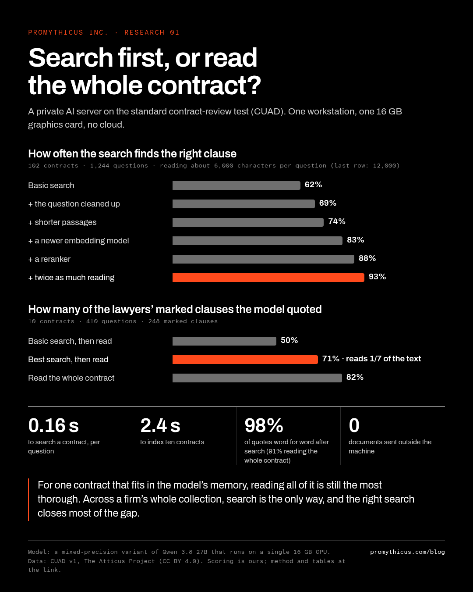

# 01. Search-then-read on CUAD

**Promythicus research. Author: Bardia Shahrestani.** Write-up for a general reader: [promythicus.com/blog/search-or-read-whole-contract-local-ai-test/](https://promythicus.com/blog/search-or-read-whole-contract-local-ai-test/)

Started 2026-11-15.

**Question.** A private document assistant can read a whole contract for every question, or search
it first and read only the best few passages. On the standard CUAD contract-review test, how much
accuracy does searching cost, how much time does it save, and which search method finds the right
clause most often?

**Data.** CUAD v1, official test split (102 contracts, 4,182 questions, 41 clause types), from the
Atticus Project (CC BY 4.0). Downloaded into `data/` by hand; not kept in git.

**Machine.** One workstation, one 16 GB NVIDIA RTX card. Model served by llama.cpp.

**Model.** a mixed-precision variant of Qwen 3.8 27B that runs on a single 16 GB GPU (the exact file is not named).

**Files.** `bench.py` (index / run / score), `pilot.sh` (the first run: 10 contracts, three ways),
`out/` (raw answers as JSONL, `scores.json`), `publish/` (what was written from it).

**Stages.**
1. Pilot: 10 contracts, 410 questions; search + 5 passages, search + 10, whole contract.
2. Search methods compared on all 102 contracts without the language model (is the right passage
   in the top 5 / top 10?): embedding models, reranker, chunking, contextual retrieval, late chunking.
3. The best search method re-run end to end.

Results are added below as each stage finishes.

## Results (2026-11-15)

**Stage 1, pilot** (`pilot.sh`; 10 contracts, 410 questions, 123 with an answer, 248 marked clauses).
First search = BGE-M3 + BM25 fused, 1,200-character passages, the CUAD question as written.

**Stage 2, search methods** (`retr.py`; all 102 contracts, the 1,244 questions that have an answer,
2,643 marked clauses; no language model). "hit" = at least one passage read holds part of an answer;
"span" = share of marked clauses that fall in a passage read. Budget 6k = about 6,000 characters read
(5 passages of 1,200 or 12 of 500), 12k = twice that. Full table: `python retr.py table`.

| Search | hit 6k | span 6k | hit 12k | span 12k |
|---|---|---|---|---|
| BM25 keywords only | 65.5 | 49.2 | 76.0 | 61.9 |
| BGE-M3, question as written | 53.6 | 39.5 | 65.0 | 49.9 |
| BGE-M3 + BM25, question as written (the pilot's search) | 62.1 | 46.5 | 73.2 | 58.9 |
| BGE-M3 + BM25, question cleaned (clause name + description) | 69.1 | 51.0 | 79.4 | 64.9 |
| same, 500-character passages | 73.5 | 55.2 | 83.8 | 68.0 |
| same, 2,400-character passages | 55.9 | 42.2 | 74.7 | 61.0 |
| same, contract title put before each passage | 66.9 | 50.8 | 78.4 | 64.9 |
| same (1,200), BGE-M3 multi-vector rescoring of the first 30 | 70.1 | 52.4 | 81.3 | 67.0 |
| same (1,200), bge-reranker-v2-m3 on the first 30 | 78.9 | 61.7 | 85.3 | 71.5 |
| same (1,200), Qwen3-Reranker-0.6B on the first 30 | 80.9 | 67.8 | 87.0 | 76.2 |
| Qwen3-Embedding-0.6B, 1,200 | 73.7 | 57.4 | 85.0 | 71.6 |
| Qwen3-Embedding-4B, 1,200 | 72.6 | 59.7 | 83.8 | 74.0 |
| Qwen3-Embedding-0.6B, 500 | 82.6 | 66.6 | 90.5 | 78.0 |
| Qwen3-Embedding-0.6B + BM25, 500 | 80.3 | 63.6 | 88.1 | 74.0 |
| **Qwen3-Embedding-0.6B, 500, Qwen3-Reranker-0.6B on the first 30** | **88.3** | **73.2** | **93.2** | **81.6** |

What mattered, in order: smaller passages, the Qwen3 embedder, a reranker, a cleaned question.
What did not: the 4B embedder over the 0.6B one, adding BM25 to the Qwen3 embedder, the contract
title before each passage, larger passages. Not tested: contextual retrieval (a model-written
sentence of context per passage), late chunking, LegalBench-RAG's CUAD subset.

**Stage 3, the best search end to end** (`best.py`, `rerun.sh`; the pilot's 10 contracts).

| Way of reading | right passage read | clauses quoted | "is there such a clause" F1 | quotes word for word | tokens read | s/question |
|---|---|---|---|---|---|---|
| first search, 5 passages | 65.9 | 50.4 | 70.2 | 98.7 | 1,269 | 2.7 |
| first search, 10 passages | 77.2 | 57.3 | 74.0 | 95.7 | 2,344 | 3.4 |
| best search, 12 short passages | 92.7 | 70.6 | 74.0 | 98.1 | 1,187 | 3.1 |
| best search, 24 short passages | 95.1 | 73.4 | 73.5 | 95.1 | 2,285 | 3.7 |
| whole contract | 100 | 82.3 | 76.9 | 90.5 | 8,374 | 3.3 |

Timing: indexing the 10 contracts (388,105 characters, 948 passages) took 2.4 s; search plus rerank
0.16 s per question. Whole-contract answers average 3.3 s only because the server keeps the contract
it has just read: the first question on each contract took 8.3 s on average (16.3 s for the longest),
against 2.5 s with the best search.

**Read of it.** Reading the whole contract is still the most thorough (82% of clauses) when one
contract fits in the model's window. Search with the best method gets 71% reading a seventh of the
text, and is the only way to ask across a whole collection. The model quoted nearly every marked
clause that the search put in front of it, so what is left to gain is in the search.

**Limits.** End to end is 10 contracts of at most 120,000 characters (10 of the 102 are longer).
Scores are ours (overlap of quoted text with the lawyers' marked spans), not CUAD's published AUPR,
so they do not compare with published numbers. One model, one run, temperature 0.

**Published from it** (`publish/`): `report.pdf` (the write-up), `infographic.png` and `infographic-fr.png`
(1080x1350, built from the `.html` beside them), `linkedin.txt`, `x.txt`. The article is in the site repo,
`posts_research.py` (EN and FR), with the infographic in `assets/research-01-cuad*.png`.

## Running it

- Everything ran on one workstation with one 16 GB NVIDIA graphics card and no cloud service.
- The larger model is named only as **a mixed-precision variant of Qwen 3.8 27B that runs on a single 16 GB GPU**. Scripts take its file from the environment:
  `export MODEL_GGUF=/path/to/your/model.gguf`. The small models are the public releases.
- Datasets and models are not in this repository; the write-up says where they come from.
- Large raw outputs (model states, patches) are left out; the scripts regenerate them.

## Licence

Code and write-ups: Apache-2.0, copyright 2026 Promythicus Tech Inc. Author: Bardia Shahrestani. Result files that quote dataset text keep the
dataset's licence (CUAD: CC BY 4.0, The Atticus Project).

One run of each, our own scoring: these numbers cannot be set beside published benchmarks. Corrections are welcome:
root@promythicus.com. More experiments: [github.com/Promythicus](https://github.com/Promythicus) ·
[promythicus.com/blog](https://promythicus.com/blog/)
